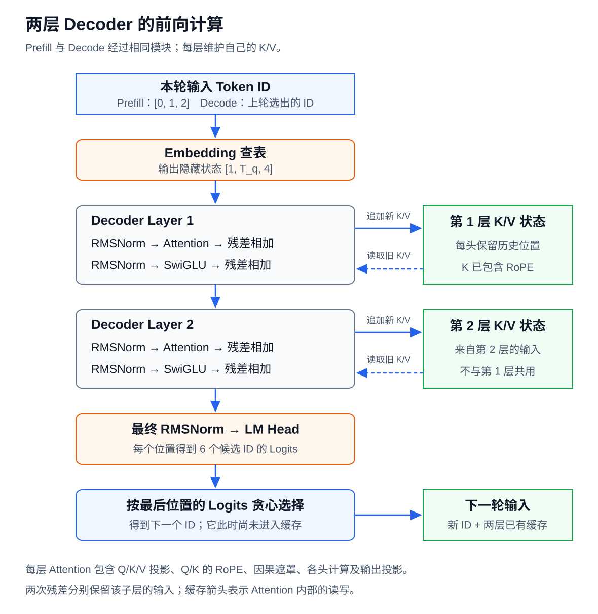

# 配套实验：Decoder 前向计算与逐步生成

这个实验把 Attention、FFN 和 KV Cache 接成一个两层 Decoder。它先处理 3 个输入 token，再完成两轮 Decode，并用同一组参数比较：改变前文、追加未来 token，以及复用缓存，分别会影响哪些结果。适合在第 6 课之后运行。

实验使用一个未经训练的小模型。它执行完整的因果 Decoder 计算，但没有语言能力；生成的 ID 只用于跟踪数据。运行不需要 GPU、PyTorch 或模型下载。

## 1. 模型与输入

模型只有两层，每层都使用多头 Full Attention 和 Dense SwiGLU FFN：

| 配置 | 本实验取值 | 含义 |
| --- | ---: | --- |
| 批次大小 `B` | 1 | 一次处理一个请求 |
| 词表大小 | 6 | Token ID 为 0 至 5 |
| 隐藏维度 `H` | 4 | 每个位置用 4 个数表示 |
| Decoder 层数 | 2 | 两层参数各自独立 |
| 查询头、K/V 头数 | 都为 2 | 使用 MHA，不共享 K/V 头 |
| 头维度 `D` | 2 | 每个头的 Q、K、V 都有 2 个数 |
| FFN 中间维度 `I` | 6 | `gate_proj`、`up_proj` 输出 6 维 |

两层均采用预归一化与两次残差连接，模型末尾还有 RMSNorm 和独立的 LM Head。RMSNorm 的缩放参数固定为 1，`epsilon=1e-6`；Linear 不使用偏置。所有参数由脚本中的固定规则生成，运行时不会改变。

它是普通的两层教学 Decoder，与 Qwen3.5 的结构不同：本实验没有 Gated DeltaNet、MoE、Q/K 归一化或 Attention 输出门控。Qwen3.5 各组件的位置仍以第 2 至第 5 课为准。

输入从分词后的 ID 开始：

```text
Token ID：  0  1  2
序列位置：  0  1  2
```

位置从 0 开始编号。Token ID 用于查 Embedding 表，位置用于 RoPE，两者用途不同。后面即使再次出现 ID 1，它也可能处在位置 3。

在仓库根目录运行：

```bash
python3 examples/full_forward_walkthrough.py
```

[完整脚本](../../examples/full_forward_walkthrough.py)使用 Python 列表保存向量。为简化代码，列表省略了始终为 1 的批次轴；正文的 shape 保留该轴，便于对照课程。

## 2. 从 Embedding 到 Logits



`Embedding[0]`、`Embedding[1]`、`Embedding[2]` 分别是：

```text
ID 0 → [1, 0, 0, 0]
ID 1 → [0, 1, 0, 0]
ID 2 → [0, 0, 1, 0]
```

查表后，输入从 `[1,3]` 的 ID 变成 `[1,3,4]` 的隐藏状态。下面跟踪最后一个输入位置，也就是 ID 2 对应的那一行。重点看两次残差相加：Attention 和 FFN 各产生一份更新，分别加到进入该子层前保存的向量上。

第 1 层中，这一行的第三个数经过以下计算。小数保留 6 位用于核对，程序内部不在步骤之间舍入：

```text
Embedding 第三个数       1.000000
Attention 给出的更新   -0.141028
第一次相加后            0.858972
FFN 给出的更新         -0.024984
第二次相加后            0.833988
```

这里只展示一个坐标的变化。计算这些更新时，模型仍使用完整向量；并不是每个坐标独立通过整层。Attention 还会读取可见位置的 K/V。

<details>
<summary>核对完整向量与归一化中间结果</summary>

| 计算结束的位置 | 位置 2 的向量 |
| --- | --- |
| Embedding | `[0, 0, 1, 0]` |
| 第 1 层：Attention 前的 RMSNorm | `[0, 0, 1.999996, 0]` |
| 第 1 层：Attention 输出投影 | `[-0.157585, 0.061353, -0.141028, 0.077910]` |
| 第 1 层：第一次残差相加 | `[-0.157585, 0.061353, 0.858972, 0.077910]` |
| 第 1 层：FFN 前的 RMSNorm | `[-0.358587, 0.139610, 1.954603, 0.177285]` |
| 第 1 层：FFN 输出 | `[-0.059882, 0.043922, -0.024984, 0.080396]` |
| 第 1 层：第二次残差相加 | `[-0.217467, 0.105275, 0.833988, 0.158306]` |
| 第 2 层：第二次残差相加 | `[-0.044606, 0.010943, 0.878500, 0.024358]` |
| 最终 RMSNorm | `[-0.101372, 0.024870, 1.996502, 0.055357]` |

</details>

第 2 层接收第 1 层更新后的向量，重复同样的步骤，但使用自己的参数。需要逐层核对时，运行 `python3 examples/full_forward_walkthrough.py --trace`。

最终 RMSNorm 后，LM Head 把 4 维向量映射成词表中 6 个 ID 的分数：

```text
候选 ID：  0          1          2          3          4          5
Logits：  -0.113440   0.819185  -0.212208   0.720417  -0.287349   0.621649
```

本实验使用贪心选择，最大分数属于 ID 1，所以第一个生成结果是 ID 1。这里不需要 Softmax。Prompt 的其他两个位置也有 Logits，但续写应使用最后一个位置的结果。

## 3. Attention 与 FFN 中的 shape

Prefill 一次处理 3 个位置。每层的中间张量如下：

| 数据 | shape | 各轴含义 |
| --- | --- | --- |
| 层输入 | `[1,3,4]` | 批次、输入位置、隐藏维度 |
| Q、K、V | 各为 `[1,2,3,2]` | 批次、头、位置、头内维度 |
| Attention 分数和权重 | `[1,2,3,3]` | 批次、头、查询位置、被读取位置 |
| 各头输出 | `[1,2,3,2]` | 每个查询位置得到一条头内向量 |
| 拼接各头后 | `[1,3,4]` | 每个位置的两个 2 维结果拼成 4 维 |
| 输出投影、第一次残差相加 | `[1,3,4]` | 回到层内隐藏状态 |
| `gate_proj`、`up_proj`、门控乘积 | 各为 `[1,3,6]` | 只改变特征宽度 |
| `down_proj`、第二次残差相加 | `[1,3,4]` | 可以继续交给下一层 |

Q/K 每个头只有一组二维坐标。位置 `p` 的旋转角度是 `p` 弧度，K 在旋转后写入该层缓存，V 原样写入。下一轮读取旧 K 时，不再旋转一次。

因果遮罩作用于查询位置和被读取位置之间。位置 0 只能读位置 0，位置 1 可以读 0、1，位置 2 可以读 0、1、2。脚本直接让 Softmax 只处理可见位置，这与把其他位置的分数设为负无穷等价。

## 4. 两轮 Decode 与缓存增长

第一个输出 ID 1 确定后，把它作为位置 3 的输入。Embedding 仍按 ID 1 查表得到 `[0,1,0,0]`，RoPE 则使用新位置 3。模型不需要再次输入 Prompt 的三个 ID，因为两层都已保存各自的历史 K/V。

| 本轮前向 | 本轮输入 ID | 输入所在位置 | `T_past` | `T_q` | `T_kv` | 本轮选出的 ID |
| --- | --- | --- | ---: | ---: | ---: | ---: |
| Prefill | `[0,1,2]` | 0、1、2 | 0 | 3 | 3 | 1 |
| Decode 第 1 轮 | `[1]` | 3 | 3 | 1 | 4 | 4 |
| Decode 第 2 轮 | `[4]` | 4 | 4 | 1 | 5 | 5 |

`T_past` 是本轮开始前的缓存位置数，`T_q` 是本轮新输入的位置数，`T_kv=T_past+T_q`。

第一轮 Decode 中，每层只新增一条 Q、一条 K 和一条 V 到每个头。Q 的 shape 是 `[1,2,1,2]`，追加后的 K/V 都是 `[1,2,4,2]`，Attention 权重则是 `[1,2,1,4]`。新 Query 要读取 4 个位置，而 FFN 只处理当前这个位置。

两轮的最后位置 Logits 分别为：

```text
Decode 1：[-0.853404, 0.269412, -0.961859, 0.160957,  0.758579, 0.052503]
Decode 2：[ 0.253075, 0.348595,  0.259690, 0.355210, -0.772653, 0.361825]
```

因此程序生成的三个 ID 是 `[1,4,5]`。结束时缓存包含输入序列 `[0,1,2,1,4]` 的五个位置；最后选出的 ID 5 尚未经过模型，不在缓存中。

## 5. 改变输入与执行方式的对照

### 5.1 改变前文：Embedding 相同，Logits 可以不同

保持权重和位置编号不变，把输入 `[0,1,2]` 改成 `[4,5,2]`。最后位置仍是 ID 2，两次查表都得到 `[0,0,1,0]`；改变的只是前两个 token。

模型的末位置 Logits 为：

```text
输入 [0,1,2]：[-0.113440, 0.819185, -0.212208, 0.720417, -0.287349, 0.621649]
输入 [4,5,2]：[-0.163507, 0.806940, -0.261768, 0.708679, -0.295274, 0.610419]
```

最后位置能够读取前两个位置，所以相同的 Embedding 经过 Decoder 后，可以得到不同的隐藏状态和 Logits。两次的最大项却仍然都是 ID 1。这说明“选出的 token 相同”不足以证明中间计算相同。模型未经训练，这个对照只验证前文能影响计算，不用于解释具体词义。

### 5.2 追加未来 token：已有位置的结果不变

把 `[0,1,2]` 扩展成 `[0,1,2,4]`，重新执行完整前向。原来的位置 0、1、2 都不能读取新位置 3，因此它们的 Logits 和各层 K/V 保持不变。脚本逐项比较这些结果，当前例子的最大误差为 0。

这里不比较两次前向各自的最后一行，因为它们分别对应位置 2 和位置 3。要验证因果约束，必须比较同一批已有位置。

### 5.3 复用缓存：结果相同，重复计算减少

以第二轮 Decode 为例，同一段上下文可以用两种方式计算：

| 方式 | 交给 `forward` 的 ID | 前向结束后用于预测的 Logits |
| --- | --- | --- |
| 不使用缓存 | `[0,1,2,1,4]` | 第五个位置的 Logits |
| 使用前四个位置的缓存 | `[4]` | 本轮唯一位置的 Logits |

两条路径的参数、上下文和位置编号相同，区别只有是否重算历史位置。脚本每轮都执行这项对照，比较完整的 6 维 Logits，不只比较最大值所在的 ID。

程序还用固定序列 `[0,1,2,4,3]` 做独立检查。五个位置之间有四处可切分位置，共 16 种分段方式，包括一次处理完、逐 token 处理和各种 Chunk 组合。它会检查：

- 分段处理后，各位置的 Logits 是否与整段前向一致；
- 两层最终的 K/V 是否与整段前向一致；
- 修改未来 token 后，前面位置的 Logits 是否保持不变；
- 故意破坏一项缓存值后，数值比较能否发现差异。

本脚本按相同顺序执行 Python 浮点计算，当前例子的最大误差为 0，断言容差设为 `1e-10`。真实 GPU 实现可能采用不同的归约顺序和精度，应根据 dtype 与任务设置容差，不能要求所有后端逐位一致。[PyTorch 数值精度说明](https://docs.pytorch.org/docs/2.15/notes/numerical_accuracy.html)

不使用缓存时，三轮分别处理 3、4、5 个位置，每层共处理 12 个位置；使用缓存后是 3、1、1，共 5 个位置。这个计数说明省去了哪些重复投影和 FFN 计算，不能直接当作加速比。新 Query 仍然需要读取历史 K/V，脚本也没有模拟 GPU、内存带宽和调度。

## 6. 阅读代码的顺序

先看 `main()` 的三轮生成，再进入 `forward()`。其中两次残差相加分别对应：

```python
after_attention = x + attention_update
layer_output = after_attention + ffn_update
```

这两行是向量关系的写法。脚本使用 `add()` 做逐元素加法，因为 Python 列表的 `+` 表示拼接。

随后检查 `past + t` 和 `visible = past + t + 1`：前者决定新位置的 RoPE，后者决定该 Query 可以读取多少个 K/V。`check_input_contrasts()` 检查第 5 节的输入对照；`check_equivalence()` 检查分块和缓存复用是否保留计算结果。

可以尝试把 Decode 的位置编号错误地重置为 0，或把 `visible` 改成所有已输入位置，再运行检查。前一种错误会破坏缓存等价性，后一种会让同一块里的早期位置看到未来。即使生成 ID 碰巧没变，Logits 或缓存比较也能暴露问题。

## 参考资料

- [Transformers：缓存原理，revision 9436284](https://github.com/huggingface/transformers/blob/943628458a1691f8af09c47ea9fc6e314734722f/docs/source/en/cache_explanation.md)
- [Transformers：Qwen3.5 实现，revision 9436284](https://github.com/huggingface/transformers/blob/943628458a1691f8af09c47ea9fc6e314734722f/src/transformers/models/qwen3_5/modeling_qwen3_5.py)。用于对照真实模型组件，不作为本教学模型参数来源。
- [PyTorch：浮点计算与批量计算的数值差异](https://docs.pytorch.org/docs/2.15/notes/numerical_accuracy.html)

---

[返回第 6 课](../lessons/06-inference-phases-and-state-reuse.md) · [课程路线](../roadmap.md) · [运行脚本](../../examples/full_forward_walkthrough.py)
